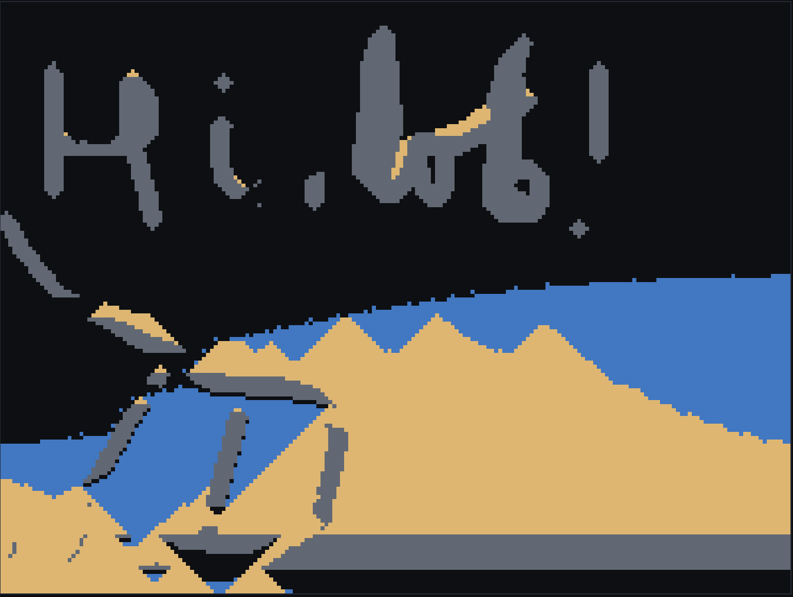
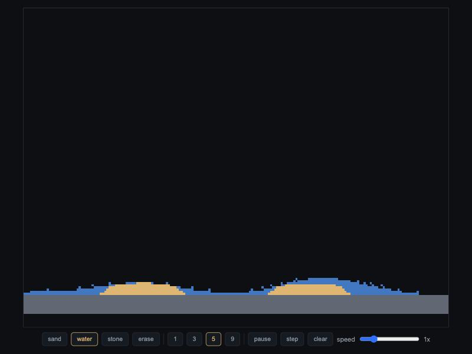

# Falling sand



A small sandbox for sand, water, and stone. Paint particles onto a 200 × 150 grid and watch them fall, pile up, and flow.

**[Play it in your browser](https://falling-sand-21735c41.netlify.app)**



## Run it

The page loads ES modules, so serve the folder instead of opening `index.html` directly.

```bash
python3 -m http.server 8000
```

Then open http://localhost:8000.

## Controls

- **sand, water, stone, erase**: pick what the brush places. Click or drag on the canvas to paint.
- **1, 3, 5, 9**: brush size in cells.
- **pause / play**: freeze the simulation. You can still paint while it is paused.
- **step**: pause and advance one step.
- **clear**: empty the grid.
- **speed**: scale the simulation from 0.25x to 4x.

## The physics

The behavior comes from a few local rules applied to every cell at a fixed rate. It is a cellular simulation, not a physics engine: each cell only looks at the cells next to it.

- **Sand** is granular. It falls one cell per step under gravity. When the cell below is blocked, it slides diagonally, so piles build up into slopes instead of flattening out. It sinks through water, like real sand, and it comes to rest on stone.
- **Water** is a fluid. It falls when it can. When it is blocked, it flows sideways toward the nearest gap that lets it drop, so it spreads across a floor and fills a container from the bottom up.
- **Stone** is immovable. It blocks sand and water, so you can build floors, walls, and channels.
- The scan direction alternates every step, so piles do not lean to one side.
- **Time** is fixed. The simulation runs at 60 steps per second whatever the display's refresh rate, so a scene plays out the same way on a 60 Hz and a 144 Hz screen. A long pause, such as a background tab, advances at most 15 steps when the page resumes, and a settled grid skips work until you paint or clear again.

## Tests

```bash
npm test
```

The tests use Node's built-in runner, `node --test`, and run without a browser. Tested with Node.js v26.0.0.

## Layout

- `src/sim.js`: particle rules and the per-step update
- `src/grid.js`: grid and cell helpers
- `src/clock.js`: fixed-timestep clock
- `src/controls.js`: pause, step, and speed scheduling
- `src/paint.js`: brush stamps, strokes, and pointer-to-cell mapping
- `src/render.js`: draws the grid to the canvas
- `src/main.js`: page controls and the frame loop
- `test/`: unit tests per module, plus whole-scene rule tests
